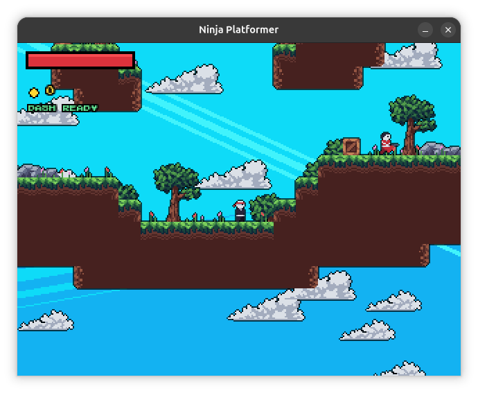
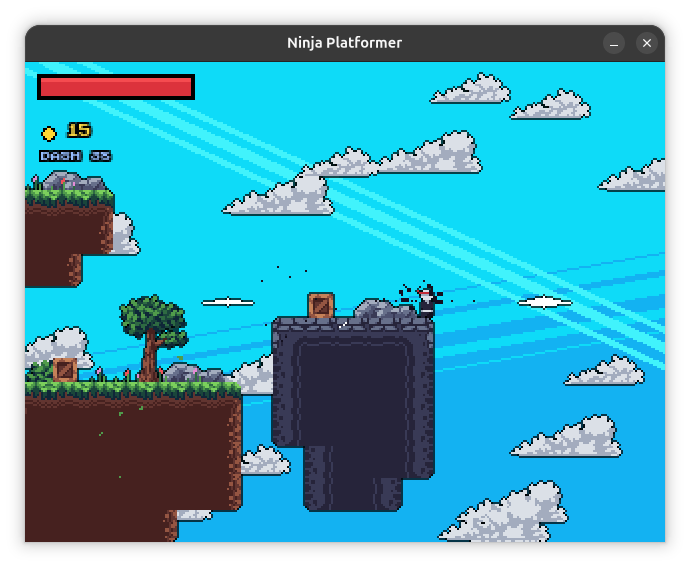
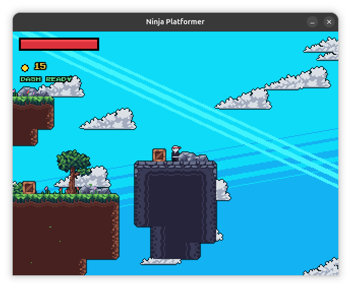
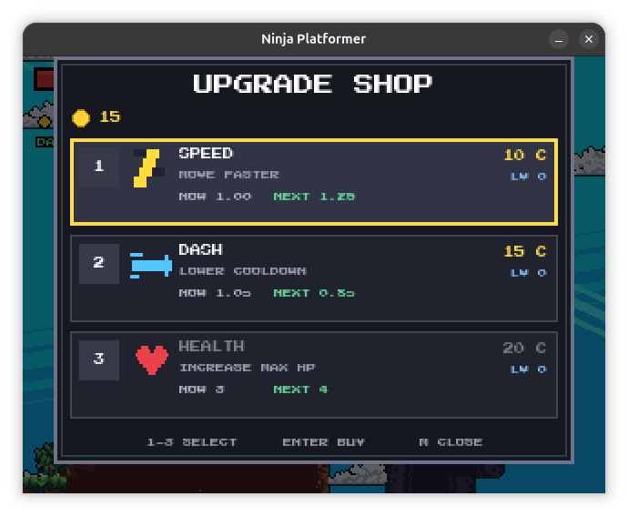
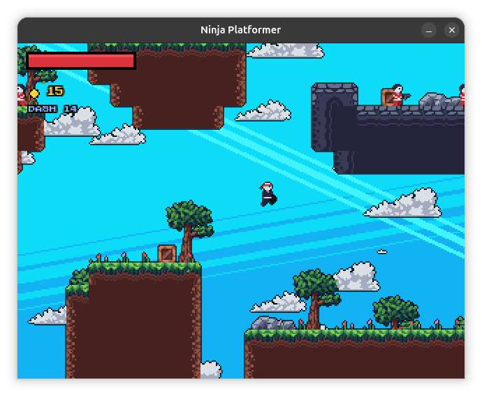
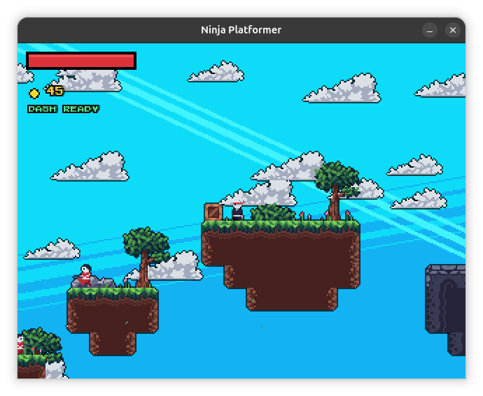
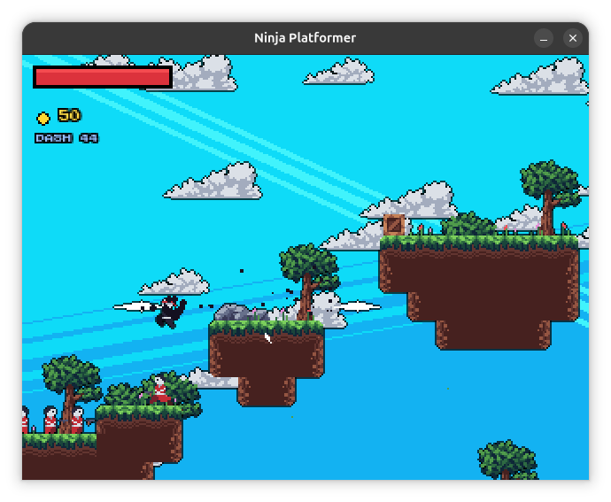
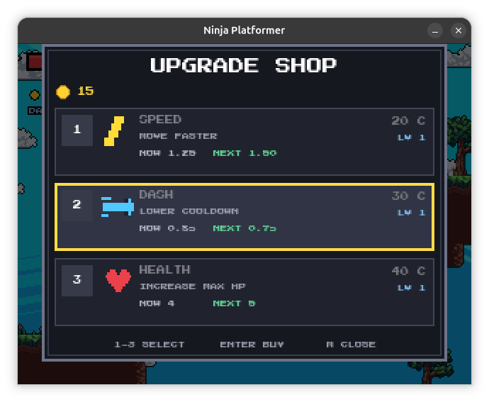

# Ninjaro

Ninjaro is a 2d ninja platformer I made using pygame!

You can jump, dash, enemies, collect coins, and buy upgrades to improve your abilities as you progress through the game.

## Controls

Arrow Keys for movement
X - dash
M - open/close shop
1 / 2 / 3 - select an upgrade in the shop
Enter - buy the selected upgrade

## Development

Pretty big game, faced many issues. One problem I ran into was packaging the game. It worked when I ran the python code, but the packaged version had trouble finding some of the game's assets, like fonts and images.

## How to play

1. Download 'Ninjaro-Linux.zip' from Release
2. Extract the zip file.
3. Open the 'Ninjaro' folder.
4. Run the 'Ninjaro' executable.

ps - this build is for ubuntu. Keep the '_internal' folder alogside the executable.

### Running from source

If you want to run the game using Python, make sure Python and Pygame are installed.

```bash
python -m pip install pygame
python game.py
```

## ai disclosure

used ai to solve packaging issues

here are some snips of my game!










ty :)
